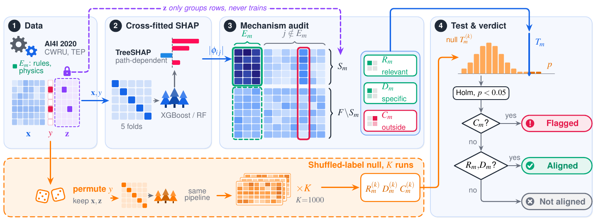

# Auditing SHAP Explanations Against Known Failure Mechanisms in Predictive Maintenance

**Koshik Debanath, Prakrit Uprety, Peiyu Li**
Department of Computer Science, South Dakota State University

Submitted to the TUAI 2026 workshop (*Towards an Understanding of Artificial Intelligence*) at IEEE BigData 2026.

[Paper](paper/main.pdf) · [Supplement](paper/supplement.pdf) · [Computational snapshot](paper/artifacts/)



## Overview

A failure-prediction model can be accurate and still base its predictions on the wrong inputs. This
repository implements a statistical audit that checks, for each documented failure mechanism, whether
held-out SHAP attributions concentrate on the features named in that mechanism's rule. Three statistics
are computed on cross-fitted explanations:

- **Relevant share** $R_m$: the share of attribution on the mechanism's observations that falls on its expected features $E_m$.
- **Specificity** $D_m$: how much larger that share is than on other failures.
- **Outside-set excess** $C_m$: how much the most-gaining feature outside $E_m$ increases its share.

Each statistic is compared with $K$ pipelines retrained on shuffled labels, with Holm correction across
mechanisms. A mechanism is *flagged* if $C_m$ is significant, *aligned* if $R_m$ and $D_m$ are, and
*not aligned* otherwise. A passing audit describes where attribution falls under a stated mechanism map;
it does not certify that the model is physically correct.

## Main results

| Data | Mechanism | Verdict |
|---|---|---|
| AI4I 2020 (synthetic milling) | heat dissipation, power, overstrain | aligned (Holm-adjusted $p=0.004$) |
| | tool wear | not aligned with path-dependent TreeSHAP; aligned against a normal-operation reference |
| | planted shortcut sensor | flagged when it takes ≥35% of attribution; weak or multi-sensor shortcuts go undetected |
| CWRU bearings (laboratory) | inner race, outer race | aligned |
| | injected acquisition-gain shortcut | flagged although every recording is classified correctly |
| Tennessee Eastman process (simulated) | reactor cooling fault (IDV4) | aligned |
| | condenser cooling fault (IDV5) | flagged on a feed valve; needs inspection |

The tuned XGBoost classifier reaches test F1 = 0.89 on AI4I 2020. Held-out explanations and the
retrained null are both necessary: without them, a model trained on shuffled labels or explained
in-sample passes the audit.

## Repository structure

```
├── src/pdm_audit/        audit statistics, data, models, metrics, AI4I process simulator
├── src/predict.py        score new sensor readings with the trained model
├── experiments/          numbered pipeline stages (01–24) and their stored results/
├── models/               tuned XGBoost model, preprocessor, hyperparameters
├── dataset/              AI4I 2020 data (UCI, CC BY 4.0)
├── tests/                unit tests for the audit statistics
├── paper/                LaTeX source and PDFs of the paper and supplement
│   ├── tables/           generated by experiments/04_tables.py
│   ├── figures/          generated by experiments/21 and 23, plus the TikZ overview
│   └── artifacts/        content-addressed computational snapshot and checksums
├── reproduce.sh          runs every stage in order and builds the paper
└── requirements.txt      pinned dependencies
```

## Installation

Python 3.11 or newer; the results were produced with Python 3.13.

```bash
git clone https://github.com/kowshik24/shap-mechanism-audit.git
cd shap-mechanism-audit
python -m venv .venv && source .venv/bin/activate
pip install -r requirements.txt -e .
python -m pytest -q
```

On macOS, XGBoost needs OpenMP (`brew install libomp`). The package sets single-threaded BLAS/OpenMP
on import to avoid runtime conflicts between NumPy, scikit-learn, XGBoost and PyTorch.

## Quick start

The tuned model and its hyperparameters are committed in `models/`, so the primary AI4I audit runs
directly. As a smoke test with a tiny null:

```bash
python experiments/02_audit.py --quick  # K=4 shuffled-label pipelines; writes experiments/results/audit_quick.json
```

Score new readings with the trained model:

```bash
python src/predict.py --csv path/to/new_readings.csv --out predictions.csv
```

The input needs the columns `Type`, `Air temperature [K]`, `Process temperature [K]`,
`Rotational speed [rpm]`, `Torque [Nm]` and `Tool wear [min]`.

## Data

- **AI4I 2020** is included in `dataset/ai4i2020.csv` ([UCI](https://archive.ics.uci.edu/dataset/601/ai4i+2020+predictive+maintenance+dataset)).
- **CWRU bearings**: `python experiments/download_cwru.py` fetches the 36 drive-end recordings from the [Case Western Reserve University Bearing Data Center](https://engineering.case.edu/bearingdatacenter) into `data/cwru/` and checksums them.
- **Tennessee Eastman process**: 400 runs (IDV4, IDV5) of the extended TEP dataset of Reinartz et al. (2021). The extraction script is `experiments/59_dtu_extract.py` on the `paper/new-experiments` branch; it writes `data/dtu_tep/prospective_runs/`.

Raw CWRU and TEP files are not redistributed.

## Reproducing the paper

```bash
./reproduce.sh          # every stage, tables, figures and both PDFs (about a day on 8 cores)
./reproduce.sh --quick  # smoke test of the audit stages with tiny K
```

Seeds are fixed, and re-running a stage reproduces its stored numbers. Tables and data figures are
generated from `experiments/results/`, never typed by hand. Per-stage scripts:

| Stage | Script | Purpose | Time |
|---|---|---|---|
| 1 | `01_benchmark.py` | model comparison, tuning, confidence intervals, saved model | ~15 min |
| 2 | `02_audit.py` | primary audit, seeds, raw-feature and in-sample variants | ~28 min |
| 3 | `03_shortcut_sweep.py` | planted shortcut at eleven strengths | ~1 h |
| 4 | `04_tables.py` | LaTeX tables in `paper/tables/` | seconds |
| 5 | `05_figures.py` | exploratory figures in `experiments/figures/` (not in the paper) | minutes |
| 6 | `06_explainers.py` | interventional TreeSHAP (3 backgrounds × 3 seeds), random forest | ~55 min |
| 7 | `07_scale.py` | audit on generated AI4I data from 10k to 300k rows | ~6 h |
| 8 | `08_compare.py` | audit-component ablations | minutes |
| 9 | `09_retuned_null.py` | null re-tuned on every permutation (`--extend-to 500`) | ~2 h |
| 10 | `10_effect_sizes.py` | null-standardized effect sizes, bootstrap intervals | seconds |
| 11 | `11_twf_diagnostics.py` | tool-wear backgrounds and raw features | ~20 min |
| 12 | `12_other_explainers.py` | MLP with KernelSHAP and Integrated Gradients | ~30 min |
| 13 | `13_review_checks.py` | label and class-weight variants, K stability, removal and direction checks | ~1 h |
| 14 | `14_cwru_audit.py` | CWRU audit with and without the gain shortcut; `--band`, `--harmonics` | ~10 min |
| 15 | `15_tep_audit.py` | TEP audit; `--window 10` adds temporal features, `--null shift` rotates labels | ~11 min |
| 16 | `16_more_checks.py` | SMOTE and ADASYN, misspecified expected sets, HSIC | ~20 min |
| 17 | `17_final_checks.py` | focal loss, pairwise reference, DeepSHAP, SmoothGrad, LIME, exact KernelSHAP | ~5 h |
| 18 | `18_dependence.py` | grouped TreeSHAP and conditional group Shapley values | ~15 min |
| 19 | `19_flag_threshold.py` | every significant outside-set flag and its excess | seconds |
| 20 | `20_rank_checks.py` | rank-based and null-referenced alternative statistics | ~15 min |
| 21 | `21_reference_figure.py` | the paper's data figures (pgfplots) | seconds |
| 22 | `22_tep_lstm.py` | TEP audit with an LSTM and Integrated Gradients | ~15 min |
| 23 | `23_twf_example.py` | single tool-wear observation under two references | seconds |
| 24 | `24_multi_proxy.py` | planted shortcut split over three sensors | ~35 min |

The AI4I stages read the tuned hyperparameters written by stage 1; stage 4 reads the results of stages
2–20, and stage 21 those of stages 2, 6, 11, 13, 17 and 18. The snapshot
`paper/artifacts/tuai-computation-5b97414ab7ef.zip` holds the code, stored results and model of the
submitted version, with a SHA-256 manifest.

## Citation

```bibtex
@inproceedings{debanath2026auditing,
  title     = {Auditing {SHAP} Explanations Against Known Failure Mechanisms in Predictive Maintenance},
  author    = {Debanath, Koshik and Uprety, Prakrit and Li, Peiyu},
  booktitle = {Proc. IEEE Int. Conf. Big Data (BigData), Workshop on Towards an Understanding of Artificial Intelligence (TUAI)},
  year      = {2026},
  note      = {Submitted}
}
```

## Contact

Koshik Debanath (koshik.debanath@jacks.sdstate.edu), Prakrit Uprety (prakrit.uprety@jacks.sdstate.edu),
Peiyu Li (peiyu.li@sdstate.edu)
