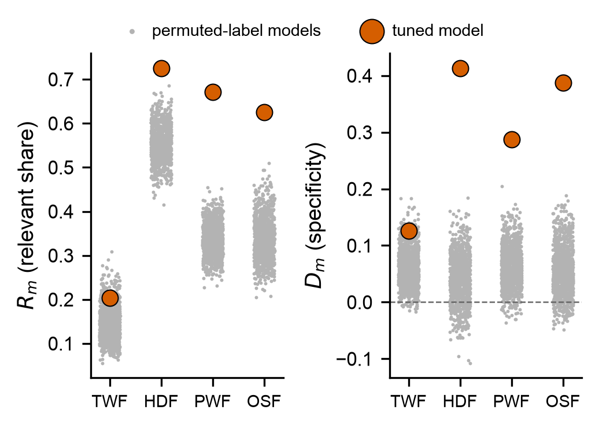
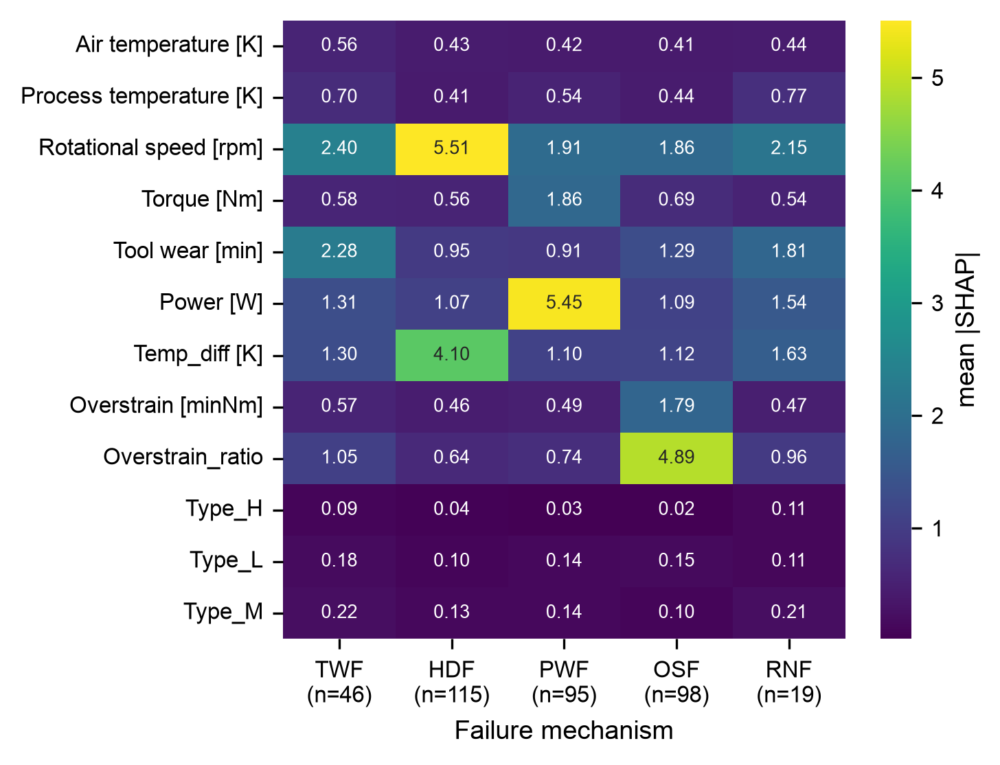

# Machine Failure Prediction


Predicts `Machine failure` on the AI4I 2020 predictive maintenance dataset, then tests whether the
model's SHAP explanations point at the physical cause of each failure, using the five mechanism
flags the model never sees in training.

Dataset: [AI4I 2020 Predictive Maintenance](https://archive.ics.uci.edu/dataset/601/ai4i+2020+predictive+maintenance+dataset)
(also in `dataset/ai4i2020.csv`) — 10,000 rows, synthetic but modeled on real industrial sensor
data, 3.39% failure rate.

## What was tried

| Stage | Techniques |
|---|---|
| Feature engineering | `Power`, `Temp_diff`, `Overstrain`, `Overstrain_ratio` — derived straight from the failure-mode physics, not generic polynomial features |
| Imbalance handling | SMOTE vs BorderlineSMOTE vs ADASYN, compared on validation F1; winner carried through |
| Dimensionality check | PCA vs t-SNE vs UMAP (diagnostic only — see below) |
| Models | Logistic Regression, SVM (RBF), KNN, Decision Tree, Random Forest, XGBoost, PyTorch MLP |
| Tuning | `RandomizedSearchCV` (F1-scored) + validation-set decision-threshold tuning on the winning model |
| Validation | 5-fold stratified CV (single 1,000-row test split isn't enough to trust on its own) |
| Calibration | Isotonic calibration check on `predict_proba` before trusting it for threshold tuning |
| Explainability | SHAP `TreeExplainer`, cross-checked against ground-truth TWF/HDF/PWF/OSF/RNF labels |
| Bonus | Multi-label model predicting the 5 failure modes directly, not just failure/no-failure |

## Results

Best model: **tuned XGBoost**, BorderlineSMOTE-resampled training set, custom decision threshold
instead of the default 0.5.

| Model | Precision | Recall | F1 | ROC-AUC |
|---|---|---|---|---|
| **XGBoost (tuned)** | **1.00** | 0.82 | **0.90** | 0.984 |
| XGBoost (baseline) | 0.86 | 0.88 | 0.87 | 0.988 |
| Random Forest | 0.79 | 0.88 | 0.83 | 0.989 |
| PyTorch MLP | 0.65 | 0.91 | 0.76 | 0.988 |
| Decision Tree | 0.68 | 0.82 | 0.75 | 0.927 |
| SVM (RBF) | 0.42 | 0.88 | 0.57 | 0.976 |
| KNN | 0.43 | 0.79 | 0.56 | 0.877 |
| Logistic Regression | 0.24 | 0.85 | 0.37 | 0.943 |

### PCA vs t-SNE vs UMAP

Three views of the same 12-dimensional training data. PCA (linear) shows the classes smeared
together with no clean separating direction. t-SNE and UMAP (both nonlinear, preserve local
neighborhoods) show the failure points clumping into several distinct pockets rather than one
region — consistent with `Machine failure` actually being five separate physical mechanisms, each
carving out its own little neighborhood in feature space instead of one shared "failure zone".


Numbers above are from `experiments/01_benchmark.py` on the 1,000-row test split (34 failures, so
the tuned model's precision of 1.00 has a 95% Clopper–Pearson interval of 0.88–1.00). 5-fold CV of the
whole pipeline (Borderline-SMOTE inside the folds, default threshold): F1 = 0.823 ± 0.016,
macro-F1 = 0.908 ± 0.009. The notebook's older CV cell used plain SMOTE and reported 0.784; the
script is the reference.

Class imbalance is why accuracy is useless here — a model that predicts "no failure" every time
still scores ~96% accuracy. Precision/recall/F1 on the failure class is what actually matters.

 

 

### Resampling, visualized

Same comparison [imbalanced-learn's own docs](https://imbalanced-learn.org/stable/auto_examples/over-sampling/plot_comparison_over_sampling.html)
run — a plain Logistic Regression fit on the 2D PCA projection, once per sampler. Without
resampling the boundary barely bends toward the minority (red) class; each oversampler drags it
further into majority territory, trading precision for recall — the same tradeoff the metrics
table above shows in numbers.


## Explainable AI — does the model know *why*?

`Machine failure` is the OR of five mechanisms, and the model is never told which one fired. For
each mechanism the audit computes out-of-sample SHAP (5-fold cross-fitting) and two statistics:

- **relevant share** R — fraction of attribution on the mechanism's rows that falls on its trigger
  features;
- **specificity** D — how much larger that share is on the mechanism's rows than on other failures.

Both are compared with 1,000 copies of the full pipeline retrained on permuted labels, with Holm
correction over the four physical mechanisms.

| Mechanism | Top out-of-sample SHAP feature | R | D | Verdict |
|---|---|---|---|---|
| TWF (tool wear) | `Rotational speed [rpm]` | 0.20 | 0.13 | fails R (p = 0.096) |
| HDF (heat dissipation) | `Rotational speed [rpm]` | 0.73 | 0.41 | passes (p = 0.004) |
| PWF (power) | `Power [W]` | 0.67 | 0.29 | passes (p = 0.004) |
| OSF (overstrain) | `Overstrain_ratio` | 0.63 | 0.39 | passes (p = 0.004) |
| RNF (random) | no dominant feature | — | — | descriptive only |

HDF, PWF, and OSF pass in all five seeds. TWF passes only when SHAP is computed on training rows,
which is why the audit uses held-out rows. Two controls: a model trained on shuffled labels fails
every test (a naive "random failure subset" null would wrongly pass it), and a planted shortcut
sensor is flagged once it takes about a third of the HDF attribution.



 

## Running it

```bash
uv venv .venv --python 3.13
source .venv/bin/activate
uv pip install -r requirements.txt
python -m ipykernel install --user --name glowing-broccoli-venv --display-name "Python 3 (venv)"
```

Open `notebooks/Exploratory-Data-Analysis.ipynb`, select the `Python 3 (venv)` kernel, run all.
Headless equivalent:

```bash
cd notebooks
jupyter nbconvert --to notebook --execute --inplace \
  --ExecutePreprocessor.timeout=1200 \
  --ExecutePreprocessor.kernel_name=glowing-broccoli-venv \
  Exploratory-Data-Analysis.ipynb
```

Takes 15-20 minutes — the hyperparameter search alone is ~200 XGBoost fits.

**Apple Silicon note:** numpy/sklearn/xgboost/torch each bundle their own threaded BLAS/OpenMP
runtime, and running them together in one Jupyter kernel segfaults the kernel with no useful
traceback. The notebook forces everything single-threaded before any other imports
(`OMP_NUM_THREADS=1`, `KMP_DUPLICATE_LIB_OK=TRUE`) — don't strip that cell out. If xgboost itself
won't import (`libomp.dylib` not found), `brew install libomp` first.

## Scoring new data

The trained model and preprocessor are committed in `models/` (`experiments/01_benchmark.py`
regenerates them):

```bash
python src/predict.py --csv path/to/new_readings.csv --out predictions.csv
```

Input needs: `Type`, `Air temperature [K]`, `Process temperature [K]`, `Rotational speed [rpm]`,
`Torque [Nm]`, `Tool wear [min]`.

## Reproducing the paper

The code in `src/pdm_audit/` (data, models, audit statistics, metrics) and the numbered scripts in
`experiments/` produce every number, table, and figure in the IEEE paper
(`paper/ieee_bigdata/main.tex`). The notebook is the exploratory record and is not needed.

```bash
./reproduce.sh          # everything, ~45 min on 8 cores; ends with paper/ieee_bigdata/main.pdf
./reproduce.sh --quick  # smoke test of the audit stages with tiny K
```

or stage by stage:

| Stage | Script | Output |
|---|---|---|
| 1 | `experiments/01_benchmark.py` | model comparison, tuning, CIs, CV, `models/` |
| 2 | `experiments/02_audit.py` | cross-fitted audit, seeds, raw-feature and in-sample variants (~28 min) |
| 3 | `experiments/03_shortcut_sweep.py` | graded shortcut experiment (~11 min) |
| 4 | `experiments/04_tables.py` | LaTeX tables in `paper/ieee_bigdata/tables/` |
| 5 | `experiments/05_figures.py` | figures in `paper/figures/` |

Stages 2–5 read the outputs of stage 1 from `experiments/results/`. Tables are generated, never
typed by hand. Seeds are fixed, and re-running a stage reproduces its numbers exactly. Unit tests for
the audit statistics: `python -m pytest`.

## Layout

```
dataset/ai4i2020.csv      raw data
src/pdm_audit/            package: config, data, models, audit statistics, metrics
src/predict.py            CLI inference on new rows
experiments/              numbered pipeline stages; results/ holds their outputs
tests/                    unit tests
models/                   saved model, preprocessor, tuned hyperparameters
paper/ieee_bigdata/       IEEE BigData submission (tables/ generated)
paper/main.tex            single-column preprint, generated by paper/sync_arxiv.py
paper/figures/            generated figures
notebooks/                exploratory notebook
reproduce.sh              runs everything in order
requirements.txt          pinned versions
```
